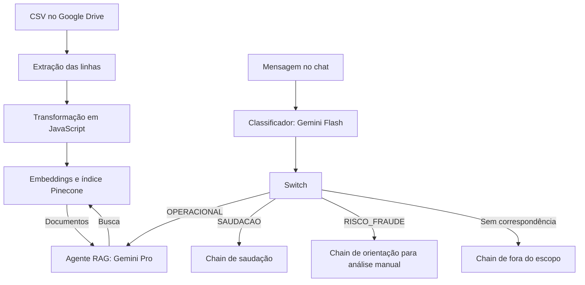

# POC de suporte iFood com RAG

   

Exercício de portfólio sobre suporte a reembolsos e cancelamentos, desenvolvido durante o processo seletivo para o Programa de Estágio em GenAI do iFood. A base de conhecimento é simulada e não representa políticas oficiais da empresa.

O workflow combina classificação de mensagens por LLM com roteamento por regras no n8n. Dúvidas operacionais seguem para um agente RAG com busca no Pinecone; saudações, suspeitas de fraude e assuntos fora do escopo seguem para chains separadas.

[Demonstração em vídeo](https://www.youtube.com/watch?v=a4R-n1ONaNI).

## Funcionamento

A ingestão é disparada manualmente: baixa-se o CSV do Google Drive, extraem-se as linhas e prepara-se o conteúdo para indexação. O chat consulta esse índice sem repetir a ingestão. O agente RAG também recebe contexto conversacional pelo nó `Simple Memory`.

## Decisões técnicas

Utiliza-se o LLM para interpretar a intenção e o `Switch` para escolher o destino a partir do rótulo. Isso deixa as regras de encaminhamento inspecionáveis sem depender de uma decisão de tool calling para cada rota. No export, as regras usam `contains` sensível a maiúsculas para `OPERACIONAL`, `SAUDACAO` e `RISCO_FRAUDE`; uma saída sem correspondência, incluindo `OUTROS`, segue para o fallback. A classificação continua sujeita a erros do modelo.

Na ingestão, o nó `Code in JavaScript` transforma cada linha do CSV em um registro com `text_to_embed`, `categoria` e `fonte`. O texto reúne fonte, categoria, cenário e ação recomendada para manter a regra e seu contexto juntos antes da indexação. O rótulo `FONTE OFICIAL` presente no template refere-se às fontes fictícias do exercício. Essa transformação preserva os campos para uso pelo document loader, mas não comprova por si só a qualidade da recuperação.

O system prompt instrui o agente a consultar a ferramenta de busca antes de responder sobre procedimentos, citar a fonte recuperada e recomendar um supervisor quando o conteúdo não sustentar a resposta. Consulta, citação e recusa são instruções ao modelo; o workflow não inclui uma validação determinística que imponha essas condições na resposta final.

Reserva-se o Gemini Pro para o agente com contexto recuperado. O Gemini Flash atende à classificação e às demais chains, enquanto os dois nós de embeddings usam o mesmo modelo para indexação e consulta. Ambos os modelos de chat estão configurados com `temperature: 0`; essa configuração não garante respostas idênticas entre execuções.

## Configuração

Requer-se uma instância n8n com os nós de IA usados no [workflow exportado](poc_ifood_genAI.json), acesso à API Gemini, um índice Pinecone e acesso ao Google Drive. A versão do n8n utilizada na POC não está registrada no export.

1. Importe `poc_ifood_genAI.json` pela opção `Import from File` do n8n, conforme a [documentação de importação](https://docs.n8n.io/workflows/export-import/).
2. Configure e associe as credenciais Gemini (`googlePalmApi`), Pinecone (`pineconeApi`) e Google Drive (`googleDriveOAuth2Api`) aos respectivos nós.
3. Envie [base_conhecimento_ifood.csv](base_conhecimento_ifood.csv) ao seu Google Drive e substitua a URL no nó `Download file`. O export aponta para o arquivo usado na POC.
4. Crie um índice Pinecone com 3.072 dimensões e métrica `cosine`, compatível com a saída padrão do [modelo de embeddings](https://ai.google.dev/gemini-api/docs/embeddings). Selecione o mesmo índice em `Pinecone Vector Store` e `Busca Docs iFood`. O nome registrado no export é `index-ifood-genai-reembolsos-cancelamentos`.
5. Confira os modelos abaixo e sua disponibilidade na conta. Se alterar o modelo de embeddings ou a dimensão, ajuste o índice e gere novamente os vetores da base.
6. Execute a ingestão pelo trigger manual e confira o conteúdo indexado, incluindo fonte, categoria, cenário e ação. Depois, teste as mensagens pelo Chat Trigger e examine a rota e as chamadas da ferramenta no histórico de execução.

| Uso | Modelo registrado no export |
|---|---|
| Classificação, saudação, fraude e fora do escopo | `models/gemini-flash-latest` |
| Agente RAG | `models/gemini-pro-latest` |
| Indexação e busca vetorial | `models/gemini-embedding-001` |

## Verificação manual

Os casos abaixo descrevem o comportamento esperado, sem representar resultados de uma suíte automatizada. Na rota operacional, verifica-se a chamada da ferramenta e se a fonte citada sustenta a resposta.

| Mensagem | Comportamento esperado |
|---|---|
| "O cliente quer reembolso, mas o pedido já saiu para entrega. Pode?" | Rota `OPERACIONAL`, consulta à base e resposta apoiada na política simulada recuperada. |
| "Esse cliente já pediu 5 reembolsos este mês, parece golpe" | Rota `RISCO_FRAUDE` e orientação para análise manual pelo time de Prevention. |
| "Oi, tudo bem?" | Rota `SAUDACAO` e resposta de boas-vindas. |
| "Qual a previsão do tempo pra amanhã?" | Classificação `OUTROS` e resposta de fora do escopo. |
| "Qual o procedimento para casos de chargeback internacional?" | Consulta à base e recusa com recomendação de supervisor, pois o CSV não contém esse procedimento. |

## Limitações

O fluxo produz orientações no chat. Não há integração com APIs de pedidos, execução de reembolsos ou abertura de tickets; o encaminhamento para análise manual também ocorre apenas na resposta.

O export registra aliases `latest` para os modelos de chat, sem fixar uma versão. A reprodução depende da disponibilidade desses aliases e da compatibilidade dos nós na instância n8n. Não há resultados quantitativos publicados de precisão, latência ou custo. Avaliar a recuperação, o cumprimento das instruções e as recusas exige um conjunto de perguntas com respostas de referência e inspeção das execuções.

## Licença

[MIT](LICENSE.md).
