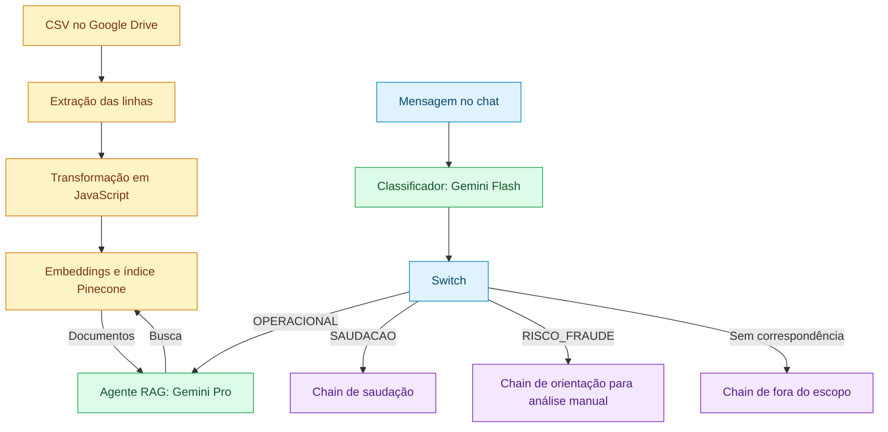

# POC de suporte iFood com RAG

   

Exercício de portfólio sobre suporte a reembolsos e cancelamentos para o Programa de Estágio em GenAI do iFood ([demonstração em vídeo](https://www.youtube.com/watch?v=a4R-n1ONaNI)). Combina classificação por LLM e roteamento por regras no n8n sobre uma base simulada.

## Configuração

Requer uma instância n8n compatível com os nós de IA de [poc_ifood_genAI.json](poc_ifood_genAI.json) (a versão exata do n8n não consta no export), conta na API Gemini, índice Pinecone e acesso ao Google Drive.

1. Importe `poc_ifood_genAI.json` via `Import from File` ([documentação do n8n](https://docs.n8n.io/workflows/export-import/)).
2. Configure credenciais Gemini (`googlePalmApi`), Pinecone (`pineconeApi`) e Google Drive (`googleDriveOAuth2Api`) nos respectivos nós.
3. Envie [base_conhecimento_ifood.csv](base_conhecimento_ifood.csv) ao Google Drive e aponte o nó `Download file` para o seu arquivo.
4. Crie índice Pinecone de `3.072` dimensões com métrica `cosine` ([embeddings Gemini](https://ai.google.dev/gemini-api/docs/embeddings)), configure-o em `Pinecone Vector Store` e `Busca Docs iFood` (nome registrado: `index-ifood-genai-reembolsos-cancelamentos`) e reindexe caso altere modelo ou dimensão.
5. Dispare a ingestão manual conferindo `fonte`, `categoria`, `cenário` e `ação`, e depois teste mensagens pelo `Chat Trigger` observando rotas e ferramentas no histórico.

| Uso | Modelo registrado no export |
|---|---|
| Classificação, saudação, fraude e fora do escopo | `models/gemini-flash-latest` |
| Agente RAG | `models/gemini-pro-latest` |
| Indexação e busca vetorial | `models/gemini-embedding-001` |

## Arquitetura e decisões

- Classificação e roteamento: Gemini Flash interpreta a intenção e o nó `Switch` encaminha via `contains` sensível a maiúsculas (`OPERACIONAL`, `SAUDACAO`, `RISCO_FRAUDE`, com `OUTROS` e falhas seguindo ao fallback), mantendo as regras inspecionáveis fora de tool calling.
- Ingestão manual e memória: o chat consulta o índice já carregado sem reingerir o CSV, mantendo histórico pelo nó `Simple Memory`. No pré-processamento, `Code in JavaScript` gera `text_to_embed`, `categoria` e `fonte` preservando regra e contexto juntos (`FONTE OFICIAL` identifica registros fictícios da POC).
- Prompt do agente RAG: instrui Gemini Pro a consultar a busca, citar a fonte e sugerir supervisor quando a base não responder. Consulta e citação dependem do prompt, sem validador determinístico posterior.
- Determinismo parcial: ambos os modelos de chat usam `temperature: 0`, mas permanecem sujeitos a variações de saída e erros de classificação.

## Verificação manual

Casos esperados para inspeção no `Chat Trigger` (não há suíte automatizada; na rota operacional, confira se a ferramenta foi chamada e sustenta a resposta):

| Mensagem | Comportamento esperado |
|---|---|
| "O cliente quer reembolso, mas o pedido já saiu para entrega. Pode?" | Rota `OPERACIONAL`, consulta ao índice e resposta apoiada na política simulada |
| "Esse cliente já pediu 5 reembolsos este mês, parece golpe" | Rota `RISCO_FRAUDE` e orientação de envio à análise manual (Prevention) |
| "Oi, tudo bem?" | Rota `SAUDACAO` com resposta de boas-vindas |
| "Qual a previsão do tempo pra amanhã?" | Rótulo `OUTROS` e resposta de fora do escopo |
| "Qual o procedimento para casos de chargeback internacional?" | Consulta à base e recusa com encaminhamento a supervisor (ausente do CSV) |

## Limitações

> [!NOTE]
> A base de conhecimento é totalmente simulada para fins de portfólio e não reflete políticas oficiais do iFood nem aciona APIs reais de pedidos, reembolsos ou abertura de chamados.

- Aliases sem versão fixa: o workflow usa tags `latest` (`gemini-flash-latest`, `gemini-pro-latest`), dependendo da disponibilidade atual desses modelos e nós na sua instância n8n.
- Ausência de métricas: não há benchmarks quantitativos de precisão, latência ou custo no repositório; medições formais exigem conjunto de avaliação anotado e leitura dos logs de execução.

## Licença

[MIT](LICENSE.md).
